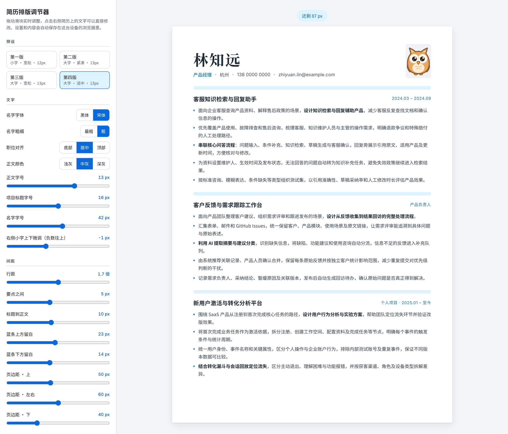

# 简历排版调节器 · resume-tuner

一个打开就能用的单文件简历排版工具。左边拖滑块，右边的 A4 简历实时变化；文字直接点击修改，调好后导出 PDF 或图片。

不用安装任何东西，不用注册，也不会上传你的数据：所有内容只保存在你自己的浏览器里。

**在线使用：[mountaindonkey.github.io/resume-tuner](https://mountaindonkey.github.io/resume-tuner/)**

## 特点

- **所见即所得**：右侧就是 A4 纸面，点击任意文字直接编辑。
- **四套预设**：小字宽松、大字紧凑、大字宽松、大字适中，一键切换后还能继续微调。
- **细致到像素的排版控制**：正文、标题、名字字号，行距，要点间距，蓝条上下留白，页边距，全部是滑块。
- **对齐与视觉校正**：职位可选底部、居中、顶部对齐；右侧小字可上下微调，解决"程序上对齐、眼睛看着不齐"的问题。
- **颜色**：强调色和分隔条颜色可选预设或自定义。
- **照片**：显示或隐藏，可上传自己的证件照（3:4 比例）。
- **自由增删内容**：要点里按回车另起一条，空要点按退格删除；可以添加或删除项目。
- **多页**：最多 3 页，每页会提示还剩多少空间、是否超出。
- **导出**：PDF（文字可复制、可被招聘系统读取）和 3 倍高清 PNG / JPG 图片。
- **自动保存**：设置和内容保存在浏览器本地，下次打开还在。

## 怎么用

1. 打开[在线版](https://mountaindonkey.github.io/resume-tuner/)，或者下载 `index.html` 用 Chrome / Edge 打开（离线也能用）。
2. 点击右侧简历上的文字，换成你自己的内容。
3. 用左侧面板调整字号、间距和颜色，直到满意。
4. 在"保存与导出"里点 **导出 PDF** 或 **导出图片**。

### 导出 PDF 的设置

点"导出 PDF"后会弹出打印窗口，请这样设置：

- 目标：**另存为 PDF**
- 纸张尺寸：**A4**
- 边距：**无**
- 更多设置里勾选 **背景图形**（不勾的话，分隔蓝条不会显示）

### 小技巧

- 选中文字按 `Ctrl + B`（Mac 为 `⌘ + B`）可以加粗，适合标出每条要点里的关键动作。
- 项目标题右边的小字适合写时间（`2024.03 – 2024.09`）、角色（`产品负责人`）或两者组合。
- 预览上方显示"超出"时，可以缩小行距和间距，或者精简要点。
- "复制当前参数"可以把你的排版数值复制下来，方便记录或分享。

## 字体

- 中文：[思源黑体 Noto Sans SC](https://fonts.google.com/noto/specimen/Noto+Sans+SC)、[思源宋体 Noto Serif SC](https://fonts.google.com/noto/specimen/Noto+Serif+SC)
- 英文与数字：[Inter](https://fonts.google.com/specimen/Inter)

字体从 Google Fonts 加载，打开文件时需要联网；离线时会使用系统自带字体代替。

## 关于示例内容

示例中的姓名、电话、邮箱和项目经历都是虚构的。默认头像是一只原创的小猫头鹰插画，可以随本项目一起使用。

## 许可证

[MIT](./LICENSE)
